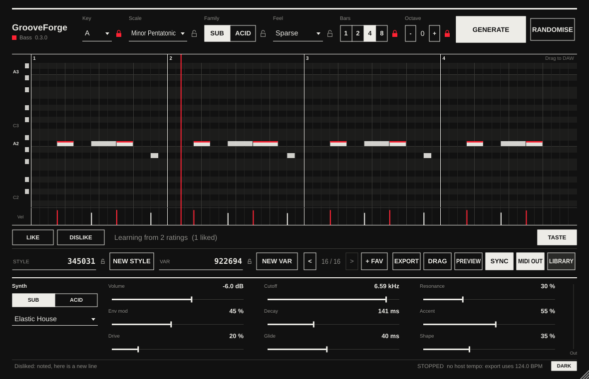

# GrooveForge Bass

Generatore di linee di basso + sintetizzatore di basso integrato, plugin **VST3 strumento** per **Windows 10/11 x64** (build anche per Linux per sviluppo/CI). Implementazione originale in C++20 + JUCE 9.0.5. Nome provvisorio.



## Cosa fa

- **GENERATE**: un clic crea una frase di basso musicale (1/2/4/8 battute, 4/4) secondo Tonalità, Scala, Famiglia, Feel, Battute e Ottava.
- Motore di generazione **deterministico e offline**: corpus originale di 81 celle ritmiche scritte a mano (tra cui celle ricavate dalle tue bassline e celle originali nello stile house/tech house groovy), grammatica ritmica con mutazioni vincolate, traiettoria di pitch condizionata sul ruolo ritmico, struttura di frase (A A' B F…), valutazione a candidati calibrata sulle tue bassline. Niente cloud.
- **Impara dai tuoi gusti (LIKE / DISLIKE)**: sotto il piano roll valuti ogni pattern. Ogni voto aggiorna subito, in locale, il profilo di gusto: ritmi, intervalli e durate che ti piacciono diventano più probabili, quelli che scarti più rari; i ritmi che ti piacciono entrano nel tuo dataset personale. Il tasto **TASTE** spegne l'apprendimento per sentire il generatore di fabbrica. Nessun dato lascia il computer.
- **Due seed**: `STYLE` (idea: archetipo, motivo, frase) e `VAR` (variazioni limitate della stessa idea). Modificabili con trascinamento (Shift = fine), rotella, frecce, doppio clic per digitare, tasto destro copia/incolla.
- **Lock** per ogni impostazione e per i seed; **History** delle ultime 64 generazioni (snapshot esatti); **Favorites** globali e persistenti, condivisi tra istanze.
- **Piano roll** che mostra esattamente il MIDI esportato (swing incluso), con playhead, velocity, accenti e slide.
- **Grafica in stile svizzero**, tema **scuro** (predefinito) o **chiaro**: un solo rosso come accento, tipografia Helvetica/Arial, griglia e filetti al posto dei riquadri. Il pulsante **DARK** in basso a destra cambia tema; la scelta vale per tutte le finestre e viene ricordata.
- **Sintetizzatore** monofonico/legato con due motori: **SUB** (sinusoide pulita + strato armonico filtrato) e **ACID** (saw/square in ladder 24 dB risonante con accent e slide). Otto macro: Volume, Cutoff, Resonance, Env Mod, Decay, Accent, Drive, Glide (+ Shape). 8 preset originali.
- **Esporta MIDI** (.mid SMF tipo 0, PPQ 960, tempo e 4/4) e **trascina** il pattern direttamente su una traccia del DAW. Opzione **MIDI OUT** VST3 (dipende dall'host).
- Sync al transport del DAW oppure **PREVIEW** a transport fermo.

## Download e installazione (consigliato)

Scarica l'ultima versione dalla sezione **Releases** del repository:

- **Windows 10/11 x64**: `GrooveForgeBass-<versione>-win64-setup.exe`. L'installer (richiede l'autorizzazione di amministratore) mette il plug-in VST3 in `C:\Program Files\Common Files\VST3\GrooveForge Bass.vst3`, installa l'app standalone e include la disinstallazione (Impostazioni → App). Non serve il Visual C++ Redistributable.
- **macOS 11+ (Apple Silicon e Intel)**: `GrooveForgeBass-<versione>-macos-universal.dmg`. Apri il DMG, esegui `Installa GrooveForge Bass.pkg` e scegli VST3, Audio Unit (Logic/GarageBand) e/o l'app. Nel DMG c'è anche lo script di disinstallazione.

Gli installer **non sono firmati**: su Windows SmartScreen può chiedere "Esegui comunque"; su macOS apri il `.pkg` con clic destro → Apri.

### Il VST3 non compare nel DAW?

Fino alla 0.2.0 c'erano due cause probabili, entrambe corrette nella 0.3.0: l'opzione "solo per me" installava il plug-in in una cartella che molti DAW non analizzano, e il plug-in richiedeva il Visual C++ Redistributable (senza, il DAW lo ignora in silenzio). Se dopo aver installato la 0.3.0 non lo vedi ancora:

1. Controlla che esista `C:\Program Files\Common Files\VST3\GrooveForge Bass.vst3\Contents\x86_64-win\GrooveForge Bass.vst3`.
2. **Ableton Live**: Impostazioni → Plug-in → attiva "Usa cartelle di sistema VST3" → Rescan.
3. **FL Studio**: Options → Manage plugins → verifica che la cartella VST3 di sistema sia nell'elenco → Find more plugins. Lo trovi tra i Generators.
4. **Cubase / Studio One / REAPER / Bitwig**: ripeti la scansione dei plug-in; in REAPER: Preferenze → Plug-ins → VST → "Re-scan".
5. Serve un DAW **64 bit**: il plug-in è solo x64.

## Requisiti di build (Windows)

- Windows 10/11 x64, **Visual Studio 2022** con il workload "Sviluppo di applicazioni desktop con C++" (MSVC + Windows SDK)
- **CMake ≥ 3.24**, Git, PowerShell
- Connessione internet alla prima configurazione (JUCE 9.0.5 viene scaricato via FetchContent). Per build offline: clonare JUCE `9.0.5` e impostare `GFB_JUCE_DIR`.

## Build, test, pacchetto (Windows)

```powershell
cmake --preset windows-x64-release
cmake --build --preset windows-x64-release
ctest --preset windows-x64-release --output-on-failure
```

Oppure con gli script (log in `artifacts\logs`):

```powershell
powershell -ExecutionPolicy Bypass -File scripts\build-windows.ps1
powershell -ExecutionPolicy Bypass -File scripts\test-windows.ps1 -Pluginval C:\tools\pluginval.exe
powershell -ExecutionPolicy Bypass -File scripts\package-windows.ps1
```

Installer `.exe` (Inno Setup 6): `scripts\build-installer-windows.ps1` → `dist\GrooveForgeBass-<versione>-win64-setup.exe`.

macOS (Xcode + CMake + Ninja): `cmake --preset macos-universal-release`, `cmake --build --preset macos-universal-release`, `./scripts/package-macos.sh` → `dist/GrooveForgeBass-<versione>-macos-universal.dmg`.

Release: il workflow `.github/workflows/release.yml` (avviato a mano con l'input `release_tag`, oppure da un tag `vX.Y.Z`) compila e testa su Windows e macOS, crea gli installer, li installa e verifica sulle macchine CI e li pubblica nella sezione Releases.

Output:

- VST3: `build\windows-x64\GrooveForgeBass_artefacts\Release\VST3\GrooveForge Bass.vst3` (cartella-bundle, non solo una `.dll`)
- Standalone: `build\windows-x64\GrooveForgeBass_artefacts\Release\Standalone\GrooveForge Bass.exe`
- Pacchetto: `dist\GrooveForgeBass-<versione>-win64.zip` + `.sha256`

La CI GitHub Actions (`.github/workflows/windows.yml`) compila e testa su `windows-2022` e pubblica lo ZIP come artifact.

## Installazione manuale (dallo ZIP)

Esegui `install-vst3-windows.ps1` (clic destro → Esegui con PowerShell; chiede l'autorizzazione di amministratore) oppure copia la cartella `GrooveForge Bass.vst3` in `C:\Program Files\Common Files\VST3\`. È l'unica cartella che tutti i DAW VST3 analizzano di default.

Poi rieseguire la scansione dei plugin nel DAW e inserire "GrooveForge Bass" come strumento su una traccia.

## Uso rapido

1. Scegli Key, Scale, Family (SUB/ACID), Feel, Bars. Premi **GENERATE** (tasto `G`).
2. Premi Play nel DAW (SYNC attivo) oppure **PREVIEW** (`P`) a transport fermo.
3. Ti piace l'idea ma vuoi varianti? **NEW VAR** (`V`) mantiene lo STYLE. Vuoi un'altra idea? **NEW STYLE** (`S`). **RANDOMISE** (`R`) cambia tutto ciò che non è bloccato.
4. Torna indietro con `<` / `>` (o Ctrl+Z / Ctrl+Y). Salva con **+ FAV** (`F`). LIBRARY apre History, Favorites e opzioni avanzate (swing, contesto ritmico della cassa, BPM di fallback, reset).
5. Premi **LIKE** quando una linea ti piace, **DISLIKE** quando no (passa subito a una nuova). Dopo una decina di voti le generazioni si spostano in modo udibile verso i tuoi gusti. In LIBRARY → TASTE vedi le statistiche, puoi esportare tutti i pattern che ti sono piaciuti come file `.mid` (il tuo dataset) o azzerare il profilo.
6. Trascina il piano roll (o il pulsante DRAG) su una traccia MIDI del DAW, oppure **EXPORT** per salvare un `.mid`.

I Favorites sono in `%APPDATA%\GrooveForgeBass\favorites.json` (con backup `favorites.bak.json`), il profilo di gusto in `%APPDATA%\GrooveForgeBass\taste.json` (con backup `taste.bak.json`). Entrambi sono condivisi da tutte le istanze del plug-in.

## Stato e limiti (onestà)

- Il binario **Windows** è prodotto e testato **solo dalla CI** su GitHub Actions; non è stato provato a mano in un DAW Windows. Vedi `docs/QUALITY_REPORT.md` e `docs/DAW_COMPATIBILITY.md`.
- L'apprendimento dai voti è statistico e locale (frequenze di ritmi, intervalli e durate + celle ritmiche apprese): non è una rete neurale e non "capisce" la musica. Con pochi voti l'effetto è leggero; cresce fino a circa 8–10 voti.
- La qualità musicale è misurata con statistiche (`reports/`), ma **non è ancora stata validata con test d'ascolto** di produttori: il protocollo è in `docs/TEST_PLAN.md`.
- Nessun legame con Bassurito: codice, corpus, suoni, nome e grafica sono originali.

## Licenze

JUCE è dual-licensed **AGPLv3 / commerciale**. Distribuire binari closed-source richiede una licenza JUCE commerciale; altrimenti il progetto va distribuito sotto AGPLv3. Dettagli in `LICENSE-THIRD-PARTY.md`.

Documentazione tecnica (inglese): `docs/ARCHITECTURE.md`, `docs/ALGORITHM.md`, `docs/TEST_PLAN.md`, `docs/QUALITY_REPORT.md`, `docs/DAW_COMPATIBILITY.md`, `docs/PLAN.md`, `CLAUDE.md`.
